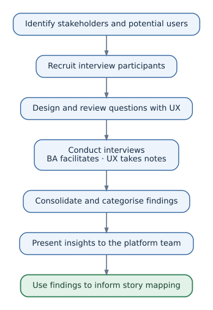

# User Interview Guide — Vault to AWS Secrets Manager

## Purpose

This guide describes the user research I conducted as a **Business Analyst in our platform team** ahead of our migration from **HashiCorp Vault to AWS Secrets Manager**. Our goal was to understand existing workflows, pain points and valued features so that the team could plan a migration informed by users' needs. AWS Secrets Manager had already been selected; the interviews were **not** intended to choose a vendor.

## Research process

### 1. Identify stakeholders and potential users

- Identified **seven groups** with different roles and interactions with Vault: developers, technical leads, QAs, project managers, product owners, **platform team members (they were the Vault administrators)** and architects.
- Wanted to understand both direct use of Vault and indirect dependencies on it.

### 2. Recruit participants

- Contacted **two representatives from each group** via Google Chat, drawing on relationships built within the project.
- Explained why we were interviewing them, what to expect and how their input could inform the migration.
- Conducted **14 individual interviews**, lasting approximately **30–45 minutes each**.

### 3. Prepare interview questions

I drafted the questions and reviewed them with **the UX designer on our platform team**. We favoured open-ended questions and examples from recent experiences rather than leading participants towards a solution. We also recorded basic context (role and team), which is not shared here.

| Interview question (edited for clarity) | What it helped us understand |
| --- | --- |
| How often do you use Vault, and for what? | Frequency and importance in daily work |
| Do you use the UI, CLI or other integrations? | Workflows and access methods |
| Think of your last interaction with Vault. What was difficult? | Pain points and recurring obstacles |
| What worked well? | Capabilities worth preserving |
| What would your ideal secrets-management experience look like? | Desired improvements and underlying needs |
| What would you expect from a replacement solution? | Expectations and migration concerns |
| How would you look for a particular secret? | Search habits, naming and organisation |
| Is there anything else you'd like to share? | Important topics we may have missed |

These questions reflect the original topics but have been lightly reworded for this portfolio.

### 4. Conduct interviews

- **My role:** Led the conversations, asked follow-up questions, listened and clarified unfamiliar workflows.
- **UX designer's role:** Took notes so I could focus on the participant. We were **both members of the platform team**.
- **Opening:** Explained the migration context, why user input mattered and that not every request could be implemented.
- **During:** Let participants describe their experience; explored relevant topics in more depth, even if we did not cover every prepared question.
- **Closing:** Paraphrased key points and asked each participant to confirm or correct my understanding, then invited additional thoughts.

### 5. Consolidate and categorise findings

- The UX designer led the initial synthesis, grouping responses into **pain points, must-haves and nice-to-haves**, and selecting illustrative user statements.
- I reviewed the synthesis with her to check that the main themes and learnings were captured.
- We **did not** send the consolidated findings back to participants for a separate validation round.
- The labels *must-have* and *nice-to-have* reflected initial user needs, **not final implementation priorities**.

See [Research Findings](research-findings.md) for the reconstructed synthesis.

### 6. Present insights to our platform team

- I presented our findings to **the rest of the platform team**, which was responsible for designing and implementing the migration.
- The discussion helped us assess which needs standard AWS Secrets Manager capabilities might address, whether additional solutions were necessary, and what required more investigation.

### 7. Use findings in story mapping

- I prepared and facilitated a **Mural workshop with our platform team**.
- The board included user flows, stakeholder groups, pain points, wishes and release lanes.
- We used the research alongside technical considerations to discuss scope and release sequencing.

See the [Story Map](../story-map/) for the reconstructed artefacts.

## Key takeaway

Having the UX designer take notes allowed me to focus on listening and probing. Bringing the findings back to **our own platform team** helped connect user experiences to technical planning without treating every request as a delivery commitment.

## Disclaimer

This file reflects my professional experience. Interview wording and supporting examples have been adjusted or reconstructed for the portfolio. No confidential records, names or secret values are included.
