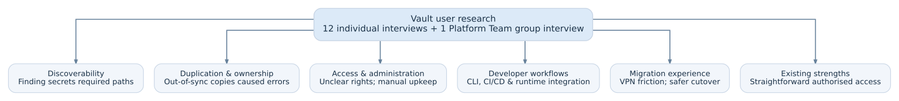

# Research Findings — Vault to AWS Secrets Manager

## Research overview

Our Platform Team was preparing a migration from HashiCorp Vault to AWS Secrets Manager. Before implementation, we wanted to understand how people used Vault, what worked, what caused difficulties, and what a replacement needed to preserve or improve.

- 12 individual interviews: Two representatives from each of six stream-aligned team roles — Developers, Tech Leads (TLs), Quality Analysts (QAs), Project Managers (PMs), Product Owners (POs), and Architects.
- 1 group interview: Our full Platform Team, including its PO, who was separate from the two POs interviewed in stream-aligned teams.
- Format: Individual interviews lasted approximately 30–45 minutes. I designed and led the interviews; the UX designer on our Platform Team reviewed the questions and took notes.
- Synthesis: The UX designer consolidated the responses. We reviewed and categorised them together, then I presented the findings to our Platform Team.
- Analysis: We identified recurring themes rather than counting how many participants raised each issue. The UX designer grouped feedback into pain points and user-expressed must-haves and nice-to-haves; these were not approved delivery priorities.

## How people used Vault

| Group | Reported usage | Main interface |
| --- | --- | --- |
| Developers and TLs | Read, create and update application secrets | CLI |
| QAs | Retrieve test-user and SauceLabs credentials | UI |
| PMs | Create and maintain shared test-user credentials | UI |
| POs in stream-aligned teams | Read secrets and ask developers to manage them | UI |
| Architects | Manage integration-related secrets, including Kafka and AsyncAPI-related use cases | CLI |
| Our Platform Team | Administer Vault, manage membership and permissions, and create or update secrets | Mainly UI and permission workflows |

Cross-cutting observation:

- All interviewees reported using Vault daily.
- Four interviewed developers/TLs did not know they could create or update secrets.
- The two POs interviewed also believed they lacked create/delete permissions, although those permissions were available. This suggested a permission-awareness problem, not necessarily missing access.

## Key findings at a glance

| Theme | What participants reported | Identified need |
| --- | --- | --- |
| **Discoverability** | Finding secrets often required knowing their exact path in the existing UI/CLI workflow. People would search by service, team, chapter or other keywords. | Find authorised secrets without remembering paths. |
| **Duplication and ownership** | Shared test credentials were duplicated. Updating one copy but not the others created inconsistencies **and errors**. Users often did not know who owned a secret. | Clear ownership and less duplication. |
| **Permissions and administration** | Some users did not know their rights. Our Platform Team's custom permissions process was cumbersome and error-prone; membership changes were repetitive. | Understand access rights and simplify administration. |
| **Developer workflows and integration** | CLI users valued their command history and wanted continued CLI access. Developers, TLs and Architects wanted better CI/CD integration. Our Platform Team wanted fewer manual copies of secrets into Kubernetes-related configurations; Architects noted code dependencies on secret identifiers. | Preserve efficient technical workflows and improve integrations and secret-update handling. |
| **Authentication and migration safety** | Most interviewees wanted access without requiring the VPN. One TL suggested letting teams select secrets for migration and allowing a grace period for errors. | Simpler but secure access, and a controlled transition. |
| **What worked well** | Once authorised and after using Vault for a while, participants generally found access straightforward, using the UI or CLI. | Preserve useful existing experiences. |

These are participant-reported experiences with our existing implementation, not claims about universal limitations of HashiCorp Vault.

## From findings to migration planning

The findings informed discussions within our Platform Team, which was responsible for the migration:

- Which needs could be met by standard AWS Secrets Manager capabilities?
- Which gaps might require configuration, automation or additional implementation?
- What needed further technical or security investigation?
- Which user activities, risks and dependencies should appear in our story-mapping workshop?
  
I used this synthesis to prepare and facilitate the user-story mapping workshop. The table above contains findings and user needs, not agreed AWS solutions or final backlog priorities.

## Related artefacts

- [Interview guide](interview-guide.md) — Recruitment, questions, interview facilitation and synthesis process.
- [Story mapping](../story-map/) — How the findings informed activities and release planning.
- [Example user stories](../user-stories/) — Illustrative requirements and acceptance criteria.
  
## Disclaimer

This document reconstructs findings from professional experience. Details are generalised or anonymised where necessary. Research themes are reported user perspectives, not independently verified product limitations or confirmed implementation outcomes.
